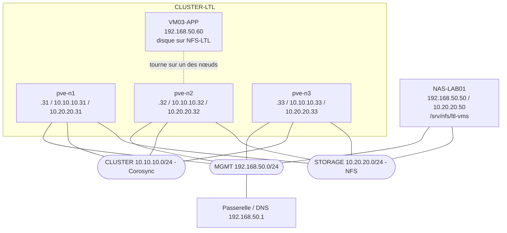

# TP Final partie 2 
## Cahier des charges 3 – Cluster de virtualisation haute disponibilité

**Client :** Léman Transports & Logistique SA
**Rédigé par :** Rrudhani Deaa  – **Date :** 25.09.2026

---

## 1. Objectif du projet

Le client ne veut plus qu'une panne de serveur arrête l'ERP. Aujourd'hui, si une VM tourne sur un seul serveur et que ce serveur tombe, la VM tombe avec lui : c'est un **point de défaillance unique (SPOF)**.

La solution est de regrouper **3 serveurs dans un cluster** : ils travaillent en équipe, se surveillent en permanence, et si l'un tombe, les autres reprennent ses VMs automatiquement.

Pour y arriver, il faut mettre en place 4 éléments :

| Élément | Rôle |
|---|---|
| **Cluster** | Les 3 serveurs se connaissent, se surveillent et partagent leur configuration |
| **Stockage partagé (NFS)** | Les disques des VMs sont stockés sur un NAS accessible par les 3 serveurs |
| **Migration à chaud** | Déplacer une VM d'un serveur à l'autre sans l'éteindre |
| **Haute disponibilité (HA)** | Redémarrer automatiquement une VM sur un autre serveur en cas de panne |

---

## 2. Lexique

| Terme | Définition |
|---|---|
| **Nœud** | Un serveur membre du cluster (ici pve-n1, pve-n2, pve-n3) |
| **Cluster** | Groupe de nœuds qui fonctionnent ensemble et partagent la même configuration |
| **Corosync** | Service qui fait communiquer les nœuds et vérifie en permanence qu'ils sont vivants |
| **Heartbeat** | Message « je suis vivant » envoyé régulièrement par chaque nœud |
| **Quorum** | Majorité de votes nécessaire pour que le cluster ait le droit de prendre des décisions |
| **NFS** | Protocole de partage de fichiers sur le réseau, utilisé ici pour stocker les disques des VMs |
| **Migration à chaud** | Déplacement d'une VM allumée vers un autre nœud, sans coupure |
| **HA** | Fonction qui redémarre automatiquement une VM ailleurs quand son nœud tombe |
| **Fencing** | Isolement d'un nœud défaillant, pour être sûr qu'il est vraiment arrêté avant de relancer ses VMs |
| **Split-brain** | Situation dangereuse où deux nœuds font tourner la même VM en même temps et corrompent son disque |
| **vzdump** | Outil de sauvegarde intégré à Proxmox |

---

## 3. Choix de la voie

J'ai choisi la **voie A (Proxmox VE)** :

- **Coût (lien avec le CDC 1)** : depuis le rachat de VMware par Broadcom, les licences sont passées en abonnement et sont devenues très chères. Proxmox est gratuit et open source.
- **Expérience (lien avec le CDC 2)** : j'ai déjà installé et configuré Proxmox (dépôts, pont vmbr0, VM, agent QEMU).
- **Tout est intégré** : cluster, HA, migration et sauvegarde sont inclus. Il n'y a pas besoin d'un serveur de gestion séparé comme vCenter : chaque nœud peut gérer tout le cluster depuis son interface web.
- **Ressources** : la voie B demande en plus une VCSA de 14 Go de RAM.

---

## 4. Architecture

### 4.1 Les trois réseaux

| Réseau | Sous-réseau | Rôle |
|---|---|---|
| **MGMT** | 192.168.50.0/24 | Administration des nœuds (interface web, SSH) et réseau des VMs |
| **CLUSTER** | 10.10.10.0/24 | Communication entre les nœuds (Corosync, heartbeats) |
| **STORAGE** | 10.20.20.0/24 | Accès des nœuds au stockage NFS |

**Pourquoi trois réseaux séparés :**
- Le trafic NFS est très volumineux (tous les accès disque des VMs y passent).
- Corosync, lui, envoie de petits messages qui doivent arriver **à l'heure**. S'ils sont retardés par du trafic lourd, un nœud peut croire qu'un autre est mort et déclencher une fausse bascule.
- En séparant les réseaux, chaque trafic a sa propre route et ne gêne pas les autres. C'est aussi plus sûr : le stockage n'est pas accessible depuis le réseau des utilisateurs.

**La passerelle (192.168.50.1)** n'est configurée que sur MGMT. CLUSTER et STORAGE sont des réseaux internes où les machines se parlent directement. De plus, une machine ne doit avoir qu'une seule passerelle, sinon elle ne sait plus par où sortir.

### 4.2 Plan d'adressage

| Machine | MGMT | CLUSTER | STORAGE |
|---|---|---|---|
| pve-n1 | 192.168.50.31 | 10.10.10.31 | 10.20.20.31 |
| pve-n2 | 192.168.50.32 | 10.10.10.32 | 10.20.20.32 |
| pve-n3 | 192.168.50.33 | 10.10.10.33 | 10.20.20.33 |
| NAS-LAB01 | 192.168.50.50 | — | 10.20.20.50 |
| VM03-APP | 192.168.50.60 | — | — |

Le NAS n'a pas de carte CLUSTER : il n'est pas membre du cluster, il fournit seulement le stockage.

### 4.3 Schéma



### 4.4 Ordre de réalisation

1. Préparer les 3 nœuds (étapes 1 à 5)
2. Préparer le NAS (étapes 6 et 7)
3. Créer le cluster (étapes 8 à 10)
4. Ajouter le stockage partagé (étape 11)
5. Créer la VM de test (étape 12)
6. Configurer la HA (étapes 13 et 14)
7. Tester : migration, panne, retour à la normale (étapes 15 à 17)
8. Mettre en place les sauvegardes (étape 18)

---

# PARTIE A – Préparation des nœuds

## Étape 1 – Installer Proxmox sur les 3 nœuds

- **Quand :** au tout début, avant toute autre configuration.
- **Que faire :** installer Proxmox VE sur les 3 serveurs, avec un nom et une IP MGMT différents pour chacun, puis les mettre à jour.
- **Comment :**
  1. Installation depuis l'ISO Proxmox (comme au CDC 2) :

     | Champ | pve-n1 | pve-n2 | pve-n3 |
     |---|---|---|---|
     | Hostname (FQDN) | pve-n1.ltl.local | pve-n2.ltl.local | pve-n3.ltl.local |
     | IP (CIDR) | 192.168.50.31/24 | 192.168.50.32/24 | 192.168.50.33/24 |
     | Passerelle / DNS | 192.168.50.1 | 192.168.50.1 | 192.168.50.1 |

  2. Sur chaque nœud : **Updates → Repositories** → désactiver les dépôts **enterprise** → **Add → No-Subscription** → **Updates → Refresh → Upgrade**.
- **Pourquoi :**
  - Les noms doivent être **uniques** : deux nœuds portant le même nom seraient impossibles à distinguer dans le cluster.
  - Le dépôt enterprise est réservé aux abonnés payants. Sans abonnement, les mises à jour échouent, d'où le passage au dépôt gratuit no-subscription.
  - La mise à jour permet d'avoir **la même version** sur les 3 nœuds (voir étape 5).
- **Résultat attendu :** les 3 interfaces web sont accessibles sur `https://192.168.50.31:8006`, `.32:8006` et `.33:8006`.

## Étape 2 – Configurer les cartes CLUSTER et STORAGE

- **Quand :** après l'installation, avant la création du cluster.
- **Que faire :** donner une IP aux deux autres cartes réseau de chaque nœud.
- **Comment :** **Nœud → System → Network** → double-clic sur chaque carte :

  | Carte | pve-n1 | pve-n2 | pve-n3 | Commentaire |
  |---|---|---|---|---|
  | 2e carte | 10.10.10.31/24 | 10.10.10.32/24 | 10.10.10.33/24 | CLUSTER |
  | 3e carte | 10.20.20.31/24 | 10.20.20.32/24 | 10.20.20.33/24 | STORAGE |

  Cocher **Autostart**, ne pas mettre de passerelle, puis cliquer sur **Apply Configuration**.
- **Pourquoi :**
  - Sans ces IP, les nœuds ne pourraient pas utiliser les réseaux CLUSTER et STORAGE.
  - L'IP est mise **directement sur la carte**, pas sur un pont (bridge) : un pont sert à brancher des VMs, or aucune VM n'utilise ces réseaux. Seul le nœud lui-même s'en sert.
  - Pas de passerelle : une machine ne doit en avoir qu'une seule, déjà définie sur MGMT.
- **Résultat attendu :** depuis pve-n1, `ping 10.10.10.32` et `ping 10.20.20.50` répondent.

## Étape 3 – Configurer la résolution de noms

- **Quand :** avant la création du cluster.
- **Que faire :** faire en sorte que chaque nœud connaisse le nom et l'IP des autres.
- **Comment :** sur chaque nœud, dans **Shell**, éditer le fichier `/etc/hosts` (`nano /etc/hosts`) et ajouter :
```
  192.168.50.31 pve-n1.ltl.local pve-n1
  192.168.50.32 pve-n2.ltl.local pve-n2
  192.168.50.33 pve-n3.ltl.local pve-n3
  192.168.50.50 nas-lab01.ltl.local nas-lab01
```
- **Pourquoi :** les nœuds s'identifient par leur nom, mais aucun serveur DNS ne connaît le domaine « ltl.local ». Le fichier hosts sert d'annuaire local. Les noms pointent vers l'IP MGMT, car c'est l'adresse que Proxmox associe au nom de chaque nœud.
- **Résultat attendu :** `ping pve-n2` depuis pve-n1 répond avec l'IP 192.168.50.32.

## Étape 4 – Synchroniser l'heure (NTP)

- **Quand :** avant la création du cluster.
- **Que faire :** faire en sorte que les 3 nœuds aient exactement la même heure.
- **Comment :** sur chaque nœud :
  1. `nano /etc/chrony/chrony.conf`
  2. Remplacer la ligne `pool …` par `pool ch.pool.ntp.org iburst`
  3. `systemctl restart chronyd`
  4. Vérifier avec `chronyc tracking` et `timedatectl`
- **Pourquoi :** les nœuds s'échangent en permanence des messages horodatés et utilisent des certificats. Si les horloges ne sont pas alignées, un nœud peut juger les messages d'un autre trop anciens et le croire en panne, et les certificats peuvent être refusés.
- **Résultat attendu :** `timedatectl` affiche **System clock synchronized: yes** sur les 3 nœuds.

## Étape 5 – Vérifier la version

- **Quand :** juste avant la création du cluster.
- **Que faire :** vérifier que les 3 nœuds ont la même version de Proxmox.
- **Comment :** `pveversion` sur chaque nœud.
- **Pourquoi :** avec des versions différentes, un nœud peut refuser de rejoindre le cluster, et les migrations peuvent échouer car les fonctions et formats ne sont pas identiques.
- **Résultat attendu :** le même numéro de version sur les 3 nœuds.

---

# PARTIE B – Le NAS

## Étape 6 – Préparer le serveur NAS-LAB01

- **Quand :** avant d'ajouter le stockage au cluster.
- **Que faire :** installer un Ubuntu Server avec deux cartes réseau.
- **Comment :**
  1. Installer Ubuntu Server, nom d'hôte `nas-lab01`.
  2. Configurer les IP avec Netplan :

     network:
       version: 2
       ethernets:
         ens18:
           dhcp4: false
           addresses:
             - 192.168.50.50/24
           routes:
             - to: default
               via: 192.168.50.1
           nameservers:
             addresses:
               - 192.168.50.1
         ens19:
           dhcp4: false
           addresses:
             - 10.20.20.50/24

  3. Appliquer avec `sudo netplan apply`.
- **Pourquoi :**
  - La carte MGMT (`ens18`) sert à administrer le NAS et à faire ses mises à jour.
  - La carte STORAGE (`ens19`) sert uniquement à fournir le partage aux nœuds.
  - La passerelle n'est que sur MGMT (une seule porte de sortie).
- **Résultat attendu :** `ip a` affiche les deux adresses.

## Étape 7 – Installer et configurer le serveur NFS

- **Quand :** juste après la préparation du NAS.
- **Que faire :** créer un dossier partagé accessible uniquement depuis le réseau STORAGE.
- **Comment :**
  1. Installer le service et créer le dossier :

     sudo apt install nfs-kernel-server -y
     sudo mkdir -p /srv/nfs/ltl-vms
     sudo chown nobody:nogroup /srv/nfs/ltl-vms

  2. Déclarer le partage dans `/etc/exports` :

     /srv/nfs/ltl-vms 10.20.20.0/24(rw,sync,no_subtree_check,no_root_squash)

  3. Appliquer et vérifier :

     sudo exportfs -ra
     sudo exportfs -v

- **Pourquoi (chaque option) :**

  | Option | Explication |
  |---|---|
  | `10.20.20.0/24` | Seul le réseau STORAGE peut accéder au partage (exigence de la consigne) |
  | `rw` | Lecture et écriture autorisées |
  | `sync` | Le NAS confirme une écriture seulement quand elle est réellement sur le disque : plus lent, mais aucune perte de données en cas de coupure |
  | `no_subtree_check` | Désactive une vérification inutile qui ralentit et peut causer des erreurs |
  | `no_root_squash` | Proxmox écrit en tant que root. Sans cette option, le NAS le transformerait en utilisateur « nobody » et Proxmox ne pourrait pas écrire |

- **Résultat attendu :** `exportfs -v` affiche le partage `/srv/nfs/ltl-vms` pour `10.20.20.0/24`.

---

# PARTIE C – Le cluster

## Étape 8 – Créer le cluster (A1)

- **Quand :** une fois les 3 nœuds préparés (étapes 1 à 5).
- **Que faire :** créer le cluster CLUSTER-LTL sur pve-n1.
- **Comment :** dans le Shell de **pve-n1** :
```bash
  pvecm create CLUSTER-LTL --link0 10.10.10.31
```
- **Pourquoi :**
  - `pvecm` est l'outil de gestion du cluster, `create` crée le cluster avec pve-n1 comme premier membre.
  - `--link0 10.10.10.31` indique que **Corosync doit utiliser le réseau CLUSTER**. Corosync est très sensible aux retards : sur un réseau dédié, ses heartbeats ne sont jamais ralentis par les autres trafics.
- **Résultat attendu :** le message de création s'affiche sans erreur, et le Datacenter affiche « CLUSTER-LTL ».

## Étape 9 – Ajouter pve-n2 et pve-n3 (A2)

- **Quand :** juste après la création du cluster.
- **Que faire :** faire rejoindre le cluster aux deux autres nœuds.
- **Comment :** la commande se lance **sur le nœud qui rejoint**, pas sur pve-n1.
  - Sur pve-n2 :

    pvecm add 192.168.50.31 --link0 10.10.10.32

  - Sur pve-n3 :

    pvecm add 192.168.50.31 --link0 10.10.10.33

  - Taper le mot de passe root de pve-n1, puis `yes` pour confirmer l'empreinte.
- **Pourquoi :**
  - `192.168.50.31` : l'adresse pour **contacter** pve-n1 et demander à entrer dans le cluster (par le réseau MGMT).
  - `--link0 10.10.10.32` : l'adresse que **ce nœud** utilisera ensuite pour Corosync.
  - Un nœud doit être vide (sans VM) pour rejoindre un cluster, car il remplace sa configuration par celle du cluster.
- **Résultat attendu :** les 3 nœuds apparaissent sous « Datacenter » dans l'interface web, et le cluster peut être géré depuis n'importe lequel.

## Étape 10 – Vérifier le cluster et le quorum (A3)

- **Quand :** après l'ajout des 3 nœuds.
- **Que faire :** vérifier que les 3 nœuds sont bien membres et que le quorum est atteint.
- **Comment :**
```bash
  pvecm status
  pvecm nodes
```
- **Pourquoi :**
  - Chaque nœud a **une voix**. Le cluster n'a le droit d'agir (démarrer une VM, déclencher la HA, modifier la configuration) que s'il a la **majorité** : c'est le **quorum**.
  - Avec 3 nœuds, la majorité est de **2**. Si un nœud tombe, les 2 autres continuent.
  - Un nœud isolé n'a qu'une voix : il se bloque de lui-même, ce qui l'empêche de lancer des VMs qui tournent peut-être déjà ailleurs.
- **Résultat attendu :**

  | Ligne de `pvecm status` | Valeur |
  |---|---|
  | Nodes | 3 |
  | Expected votes / Total votes | 3 / 3 |
  | Quorum | 2 |
  | Quorate | Yes |

  `pvecm nodes` liste les 3 nœuds avec 1 vote chacun.

---

# PARTIE D – Le stockage partagé

## Étape 11 – Ajouter le stockage NFS au cluster (A4)

- **Quand :** une fois le cluster créé et le NAS prêt.
- **Que faire :** monter le partage NFS sur les 3 nœuds sous le nom NFS-LTL.
- **Comment :** **Datacenter → Storage → Add → NFS** :

  | Champ | Valeur |
  |---|---|
  | ID | NFS-LTL |
  | Server | 10.20.20.50 |
  | Export | /srv/nfs/ltl-vms |
  | Content | Disk image, ISO image, VZDump backup file |
  | Nodes | Tous |

- **Pourquoi :**
  - **Le stockage partagé est la condition de tout le reste** : si le disque d'une VM est sur le disque local d'un nœud et que ce nœud tombe, les autres ne peuvent pas y accéder. Il n'y a alors ni migration ni HA possible.
  - On utilise l'IP **10.20.20.50** (STORAGE) et pas 192.168.50.50, pour que le trafic des disques passe par le réseau dédié. De plus, le NAS n'accepte que 10.20.20.0/24.
  - On l'ajoute au niveau **Datacenter** parce que la configuration est partagée : les 3 nœuds montent le partage automatiquement.
  - Les types de contenu : disques des VMs, ISOs visibles depuis tous les nœuds, et sauvegardes (étape 18).
- **Résultat attendu :** NFS-LTL apparaît sous chacun des 3 nœuds, et `pvesm status` le montre **active** partout.

---

# PARTIE E – La VM de test

## Étape 12 – Créer VM03-APP

- **Quand :** une fois le stockage partagé disponible.
- **Que faire :** créer la VM qui servira à tester la migration et la HA.
- **Comment :** sur pve-n1, **Create VM** :

  | Paramètre | Valeur |
  |---|---|
  | ID / Nom | 300 / VM03-APP |
  | OS | Ubuntu Server |
  | CPU | 1 vCPU, type par défaut (x86-64-v2-AES) |
  | RAM | 1 Go |
  | Disque | 10 Go **sur NFS-LTL** |
  | Réseau | vmbr0, VirtIO |
  | Qemu Agent | Coché |

  Après l'installation : IP `192.168.50.60/24` avec Netplan, installation de `qemu-guest-agent`, et retrait de l'ISO (**Hardware → CD/DVD → Do not use any media**).
- **Pourquoi :**
  - **Disque sur NFS-LTL** : pour que les 3 nœuds puissent accéder au disque.
  - **CPU par défaut** : c'est un processeur générique identique sur tous les nœuds, ce qui permet de migrer la VM même si les nœuds n'ont pas le même processeur physique.
  - **Retrait de l'ISO** : un CD monté peut bloquer la migration ou le redémarrage de la VM sur un autre nœud.
- **Résultat attendu :** la VM démarre, répond au ping sur 192.168.50.60, et son disque apparaît dans NFS-LTL.

---

# PARTIE F – La haute disponibilité

### Fonctionnement de la HA dans Proxmox

| Composant | Rôle |
|---|---|
| **CRM** (Cluster Resource Manager) | Un seul nœud est « maître » : il décide où chaque VM protégée doit tourner |
| **LRM** (Local Resource Manager) | Présent sur chaque nœud : il exécute les ordres du CRM et signale qu'il est vivant |
| **Watchdog** | Minuteur qui redémarre de force un nœud qui a perdu le quorum, pour garantir qu'il arrête ses VMs |

## Étape 13 – Définir les nœuds autorisés (A5)

- **Quand :** après la création de VM03-APP.
- **Que faire :** indiquer sur quels nœuds la VM a le droit de redémarrer.
- **Comment :** cela dépend de la version de Proxmox :
  - **Proxmox VE 8** : **Datacenter → HA → Groups → Create** → ID `HA-LTL` → cocher les 3 nœuds.
  - **Proxmox VE 9** : les groupes ont été remplacés par les **règles d'affinité de nœud**, qui font la même chose. **Datacenter → HA → Rules → Add → HA Node Affinity** → cocher les 3 nœuds → sélectionner la ressource vm:300. Dans cette version, il faut d'abord ajouter la ressource (étape 14), puis créer la règle.
- **Pourquoi :** on peut vouloir limiter une VM à certains nœuds (par exemple ceux qui ont assez de RAM). Ici, les 3 nœuds ont la même priorité, donc la VM peut redémarrer sur n'importe lequel.
- **Résultat attendu :** le groupe (ou la règle) apparaît avec les 3 nœuds.

## Étape 14 – Protéger VM03-APP (A6)

- **Quand :** juste avant (Proxmox 9) ou juste après (Proxmox 8) l'étape 13.
- **Que faire :** mettre la VM sous la surveillance de la HA.
- **Comment :** **Datacenter → HA → Resources → Add** :

  | Champ | Valeur | Signification |
  |---|---|---|
  | VM | 300 | La VM à protéger |
  | Max. Restart | 1 | Si la VM plante, une tentative de redémarrage sur le même nœud |
  | Max. Relocate | 1 | Si ça échoue, un déplacement vers un autre nœud |
  | Request State | started | La VM doit toujours être allumée |

- **Pourquoi :** sans cette étape, Proxmox ne surveille pas la VM : si son nœud tombe, elle reste éteinte.
- **Résultat attendu :** `ha-manager status` affiche le quorum OK, un maître, les 3 LRM « active », et `service vm:300 (pve-n1, started)`.

---

# PARTIE G – Les tests

## Étape 15 – Migration à chaud (A7)

- **Quand :** une fois la HA configurée et la VM allumée.
- **Que faire :** déplacer VM03-APP de pve-n1 vers pve-n2 sans l'éteindre, et mesurer la coupure.
- **Comment :**
  1. Depuis une autre machine (le NAS), lancer un ping continu :
```bash
     ping -D -O 192.168.50.60
```
     `-D` affiche l'heure de chaque réponse, `-O` signale chaque paquet sans réponse.
  2. Clic droit sur VM03-APP → **Migrate** → cible **pve-n2**, mode **Online**.
  3. Attendre « migration finished successfully ».
  4. Arrêter le ping avec **Ctrl + C** et relever la ligne `packets transmitted, received, % packet loss`.
- **Pourquoi / ce qui se passe :**
  1. Proxmox copie la RAM de la VM vers pve-n2 pendant qu'elle continue de tourner.
  2. Il recopie plusieurs fois les parties de la mémoire modifiées entre-temps, jusqu'à ce qu'il en reste très peu.
  3. Il met la VM en pause quelques millisecondes, copie le dernier morceau, puis la relance sur pve-n2.
  4. **Le disque n'est pas copié**, puisqu'il est sur le NFS, déjà accessible par les deux nœuds.
- **Amélioration :** dans **Datacenter → Options → Migration Settings**, choisir le réseau `10.10.10.0/24` pour que la copie de la RAM ne sature pas le réseau MGMT.
- **Résultat attendu :** 0 ou 1 paquet perdu, et VM03-APP apparaît sous pve-n2.

## Étape 16 – Simulation de panne

- **Quand :** après la migration, quand VM03-APP tourne sur pve-n2.
- **Que faire :** couper brutalement pve-n2 et mesurer le temps de reprise.
- **Comment :**
  1. Relancer le ping continu depuis le NAS.
  2. Couper brutalement pve-n2 (débrancher l'alimentation, ou « Stop » dans un lab virtualisé). Noter l'heure : **T0**.
  3. Observer l'interface web et `ha-manager status` depuis pve-n1.
  4. Noter l'heure de la première réponse au ping : **T1**.
  5. **Temps de reprise = T1 − T0.**
- **Pourquoi une coupure brutale :** un arrêt propre (Shutdown) n'est pas une vraie panne. Une panne réelle ne prévient pas.
- **Déroulement attendu :**

  | Phase | Ce qui se passe | Durée approximative |
  |---|---|---|
  | Détection | Corosync ne reçoit plus les heartbeats de pve-n2, qui passe en rouge | Quelques secondes |
  | Fencing | La VM passe en état « fence » : le cluster attend d'être sûr que pve-n2 est arrêté | 1 à 2 minutes |
  | Relance | Le CRM redémarre VM03-APP sur pve-n1 ou pve-n3 | Immédiat |
  | Démarrage | Ubuntu démarre, le ping répond à nouveau | 30 à 60 secondes |

- **Pourquoi la HA attend (fencing) :** le cluster doit être **certain** que pve-n2 est vraiment arrêté, et pas simplement coupé du réseau. Si pve-n2 était encore vivant et que la VM démarrait aussi ailleurs, deux copies de la même VM écriraient sur le même disque NFS : c'est le **split-brain**, et le disque serait corrompu. Proxmox attend donc le délai au bout duquel le watchdog d'un nœud isolé l'a forcément redémarré.
- **Résultat attendu :** VM03-APP redémarre sur un autre nœud, avec une coupure d'environ **2 à 3 minutes**.

## Étape 17 – Retour à la normale

- **Quand :** après la simulation de panne.
- **Que faire :** redémarrer le nœud en panne et vérifier qu'il réintègre le cluster.
- **Comment :**
  1. Rallumer pve-n2.
  2. Vérifier avec `pvecm status` et `ha-manager status`.
- **Pourquoi :** il faut s'assurer que le cluster retrouve ses 3 nœuds, et donc sa tolérance à une nouvelle panne.
- **Résultat attendu :**
  - `pvecm status` : 3 nœuds, **Quorate : Yes** ; `ha-manager status` : les 3 LRM « active ».
  - VM03-APP **reste** sur le nœud où elle a redémarré : les 3 nœuds ont la même priorité, donc rien ne justifie de la déplacer à nouveau, et chaque déplacement comporte un risque. Si un nœud avait une priorité plus élevée, elle y retournerait automatiquement (failback).

---

# PARTIE H – Les sauvegardes

## Étape 18 – Sauvegarde planifiée et manuelle (A8)

- **Quand :** une fois la VM en production et protégée.
- **Que faire :** programmer une sauvegarde quotidienne de VM03-APP vers le NFS, et en réaliser une tout de suite.
- **Comment :**
  1. **Datacenter → Backup → Add** :

     | Champ | Valeur | Pourquoi |
     |---|---|---|
     | Node | Tous | La VM peut se trouver sur n'importe quel nœud après une migration ou une bascule |
     | Storage | NFS-LTL | Accessible depuis tous les nœuds |
     | Schedule | 02:00 | Tous les jours à 2h, quand personne ne travaille |
     | Sélection | VM 300 | La VM demandée |
     | Mode | Snapshot | La VM continue de tourner pendant la sauvegarde |
     | Compression | ZSTD | Rapide et efficace |
     | Retention | Keep Daily 7 | Une semaine d'historique, les plus anciennes sont supprimées automatiquement |

  2. Sauvegarde manuelle : sélectionner le job → **Run now** (ou VM03-APP → **Backup → Backup now**).
- **Pourquoi :**
  - **vzdump** est l'outil de sauvegarde de Proxmox : le job planifié l'appelle automatiquement.
  - En mode **Snapshot**, l'agent QEMU fige brièvement le système de fichiers pour garantir une copie cohérente, sans arrêter la VM. Les modes **Suspend** et **Stop** coupent le service pendant la sauvegarde.
  - La HA protège contre la panne d'un serveur, mais **pas** contre une suppression, un ransomware ou une corruption : seule une sauvegarde le permet.
- **Limite :** les sauvegardes sont sur le **même NAS** que les disques des VMs. Si le NAS tombe, on perd tout, ce qui ne respecte pas la règle 3-2-1. En production, il faudrait un **Proxmox Backup Server** séparé, avec une copie hors site.
- **Résultat attendu :** la tâche se termine par **TASK OK**, et un fichier `vzdump-qemu-300-….vma.zst` apparaît dans **NFS-LTL → Backups**.

---

# PARTIE I – Analyse

## 1. Pourquoi 3 nœuds et pas 2 ?

Le cluster fonctionne par vote : chaque nœud a une voix, et il faut la majorité (le quorum) pour prendre des décisions. Avec 3 nœuds, le quorum est de 2 : si un nœud tombe ou est isolé, les 2 autres gardent la majorité et continuent.

Avec 2 nœuds, si le lien CLUSTER est coupé, chacun se retrouve seul avec 1 voix sur 2. Aucun n'a la majorité : les deux se bloquent, la HA ne peut redémarrer aucune VM et la configuration passe en lecture seule. Ce blocage évite le split-brain, mais il n'y a plus de haute disponibilité.

## 2. Pourquoi séparer MGMT, CLUSTER et STORAGE ?

- **CLUSTER** : Corosync est très sensible à la latence. Un heartbeat retardé par un gros transfert peut faire croire qu'un nœud est mort et déclencher une bascule inutile.
- **STORAGE** : le trafic NFS est très volumineux et ne doit pas ralentir l'administration ni le cluster.
- **Sécurité** : le stockage n'est pas accessible depuis le réseau des utilisateurs.
- **Dépannage** : on sait quel trafic passe où, donc on trouve plus vite l'origine d'un problème.

## 3. Migration à chaud et basculement HA

| | Migration à chaud | Basculement HA |
|---|---|---|
| Déclenchement | Planifié par l'administrateur | Automatique, après une panne |
| Paquets perdus | 0 à 1 | Plusieurs dizaines |
| Interruption | Quelques millisecondes | Environ 2 à 3 minutes |
| Redémarrage | Aucun : la VM continue de tourner | Redémarrage à froid, comme après une coupure de courant |
| Mémoire de la VM | Conservée (copiée vers l'autre nœud) | Perdue |

La migration déplace une VM vivante. Le basculement HA relance une VM dont le nœud s'est arrêté d'un coup : il faut détecter la panne, attendre le fencing pour éviter le split-brain, puis redémarrer complètement le système.

## 4. Point de défaillance unique restant

**Le NAS** : c'est le seul serveur de stockage. S'il tombe, aucun nœud n'accède plus aux disques des VMs, et la HA devient inutile (les nœuds sont vivants mais n'ont plus de disques).

**Solutions pour la production :**
- Remplacer le NAS unique par **Ceph**, un stockage réparti et répliqué sur les 3 nœuds : chaque donnée existe en plusieurs copies sur des nœuds différents. Autre option : un SAN à double contrôleur.
- Serveurs avec double alimentation et cartes réseau agrégées (bonding) vers deux switches.
- Sauvegardes sur un Proxmox Backup Server séparé, avec une copie hors site.

## 5. Capacité restante en cas de perte d'un hôte (lien avec le CDC 1)

Au CDC 1 : 3 hôtes avec un AMD EPYC 9124 (32 threads) et 256 Go de RAM chacun.

Si un hôte tombe, il en reste 2. En retirant la réserve de l'hyperviseur (4 threads et 8 Go par hôte) :
- **Threads disponibles** : 2 × (32 − 4) = **56 threads**
- **RAM disponible** : 2 × (256 − 8) = **496 Go**

| | Besoin des 15 VMs | Marge threads | Marge RAM |
|---|---|---|---|
| Aujourd'hui | 34 threads / 272 Go | 22 threads | 224 Go |
| Dans 3 ans (+30 %) | 45 threads / 354 Go | 11 threads | 142 Go |

Avec une VM standard type SRV-WEB (2 vCPU, 4 Go, ratio 3:1, soit 3 vCPU par thread) :
- **Aujourd'hui** : 22 × 3 = 66 vCPU, soit 33 VMs (CPU) ; 224 ÷ 4 = 56 VMs (RAM). Le CPU limite : environ **33 VMs** supplémentaires.
- **Dans 3 ans** : 11 × 3 = 33 vCPU, soit 16 VMs (CPU) ; 142 ÷ 4 = 35 VMs (RAM). Environ **16 VMs** supplémentaires.

Pour des VMs critiques (ratio 1:1), la marge serait bien plus faible : dans 3 ans, 11 ÷ 2 = **5 VMs**.